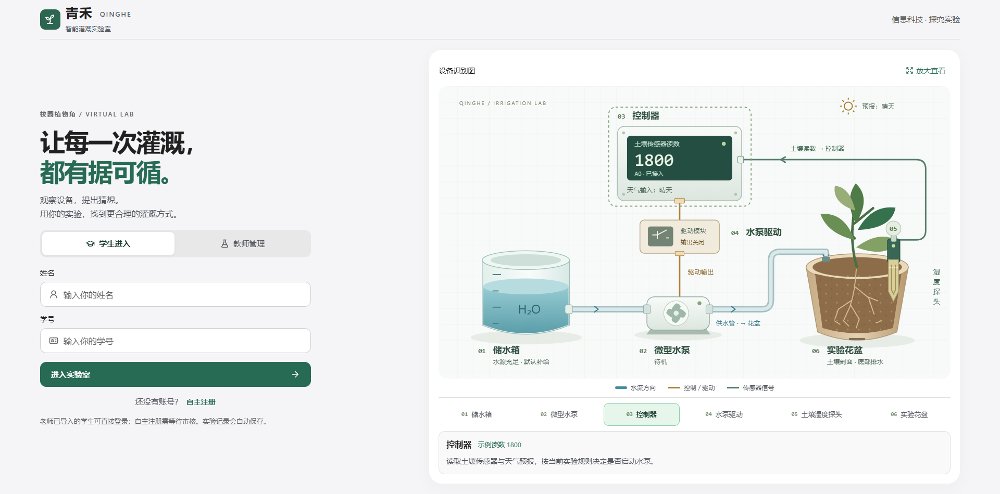

# 青禾智能体灌溉实验平台

面向八年级自动灌溉探究的可运行前后端应用。学生操作虚拟设备、完成五阶段任务、获得四种条件下的指导；教师管理名单、配置实验、查看进度和导出研究数据。



技术栈：React / Vite、Express、SQLite、Vercel AI SDK、p-queue。支持本地运行与Node服务器部署，完整配置见[部署说明](docs/deployment.md)。

## 本地启动

要求 Node.js 24 或更高版本。

```powershell
cd qinghe-irrigation-lab
npm ci
npm run setup
npm run dev
```

打开 http://127.0.0.1:5173 。`setup`准备初始教师账号与密码，并生成本机的`本地登录说明.txt`；旧版访问码会一次性迁移为初始密码，模型配置保留。`.env`和本地登录说明均已排除在Git和Docker构建上下文之外。

`seed`是可选的本地演示初始化，不清空数据库：

```powershell
npm run seed
```

| 姓名 | 学号 | 条件 |
|---|---|---|
| 演示学生1 | 20260001 | 主动＋线索 |
| 演示学生2 | 20260002 | 主动＋详细解释 |
| 演示学生3 | 20260003 | 响应＋线索 |
| 演示学生4 | 20260004 | 响应＋详细解释 |

正式部署不执行seed。可由教师导入学生名单，或由学生自主注册、管理员审核。学号按文本保存，保留前导零。

## 账号与用户资料

教师使用“账号＋密码”登录。初始管理员账号默认`admin`，初始密码见本地登录说明；首次启动时写入数据库，之后重启不会重置密码。在“账号与资料”中可修改自己的姓名和密码。教师共同管理本平台实验；只有管理员可审核注册申请、直接添加教师及查看全部用户资料。

学生使用“姓名＋学号”登录。教师导入的学生可直接登录；自主注册的学生须先通过管理员审核并分配实验。学号在平台内唯一；同一学生参加多轮实验时，登录后选择实验。姓名、学号属于用户资料，班级、分组和实验成果属于各轮报名记录，刷新或重启不会丢失。

登录页点击“自主注册”，学生填写姓名、学号、班级；教师填写姓名、账号、密码，可补充任教信息。申请提交后处于待审核状态，不会自动登录。管理员在“注册审核”中逐个或批量通过、拒绝申请；拒绝时填写原因，申请人再次登录可看到结果。未通过的申请可由管理员重新审核通过，无须重复注册。

通过学生申请时，管理员必须选择开放中的实验和分组方式。支持指定四种实验条件之一，或明确选择“按当前人数均衡分配（临时）”；均衡分配不等同正式随机分组。学生首次登录前，仍可在“学生与分组”中调整。审核结果与实验报名一起保存，通过后即可登录。操作说明见[注册与审核](docs/registration.md)。

升级前先备份数据库并运行`npm run setup`。启动自动增加用户资料表并保留原学生id、进度及成果；旧教师会话需要重新登录。没有真实学号的旧学生标为“待补充学号”，由教师在“学生与分组→编辑资料”中补齐，不会拿随机访问码充当真实学号。

密码使用bcrypt存储，不向前端或研究导出返回密码或密码摘要。

## 已有功能

- 学生：前测、初步猜想、设备参数与连接操作、30分钟过程仿真、测试记录回放、条件与阈值规则编辑、验证、后测、实验报告下载。
- 指导：主动/响应×线索/详细解释四种条件由后端执行；首次猜想前默认禁用；停滞、关键测试、结构化预测不符、重复测试和阶段完成可触发，支持去重及冷却。
- 教师：创建多轮实验、逐个或批量导入学生、手动条件分配、班级/前测区组随机分配、暂停/开放、学生档案、参数表单及完整JSON配置。管理员还可审核学生和教师的自主注册申请，支持批量处理。
- 数据：SQLite持久化，学生刷新或重登可继续；原始提交、测试、规则修改、对话、事件和开始时配置快照保留；CSV/JSON导出；在线数据库备份。
- 模型：支持DeepSeek及OpenAI兼容Chat Completions接口，个人模型配置、连接测试和教师发布实验默认模型；也提供显式的预设教学指导模式。接口失败保留实验数据并报错，不暗中替换指导模式。

## 智能体运行与效率

当前采用单教学智能体与确定性教学工作流，正式使用 Vercel AI SDK（`ai` 7.0.162、OpenAI-compatible provider 3.0.84）接入模型。四种实验条件共用一个教学助理，按介入时机和解释深度区分；LangGraph暂未安装，选型理由见下方架构说明。

实验保存和阶段推进立即返回；智能指导由后台有界队列生成，学生可继续操作，页面会显示等待、生成、成功或失败。前后测强制独立作答；换阶段和暂停时取消过期指导。每次模型调用只发送原始观察、阶段任务、关键草稿及近期证据，完整研究记录继续保留。

默认同时生成8条指导，最多等待128条，排队超过60秒明确提示失败。可通过 `.env` 中的 `AI_MAX_CONCURRENT`、`AI_QUEUE_LIMIT`、`AI_QUEUE_WAIT_MS` 调整，不应把并发数设得高于服务商配额。使用 p-queue 10.0.0，四种条件共用先进先出队列，不自动重试或更换模型。任务记录包括提示词版本、排队时间、生成时间及服务商返回的token用量，可在学生档案的“指导运行”查看，并导出CSV或完整研究JSON中的 `guidanceRuns`。

明确询问测试编号时，可检索该学生较早的记录，而非只能看到最近8条；当前最多补充4条明确引用。草稿串行保存，求助前等待自己的文本落库；同阶段测评、规则及测试变化也会通过状态版本同步。自动介入未执行的离散事件保留跳过原因，便于核对各组的实际指导次数。

架构与开源选择见[智能体架构说明](docs/agent-architecture.md)。可执行 `npm run check:agent -- --live` 做9个合成教学场景的实际模型抽测；会产生9次付费API请求，不读取真实学生资料或修改正式数据库。报告保存于本机 `output/agent-live-check.json`。

## 大模型连接

教师和学生均可在“模型设置”中填写自己的 API 地址、密钥和模型 ID，测试连接、保存启用或恢复默认。教师还能将已保存的配置发布为当前实验默认模型。学生指导使用顺序为“学生个人模型 → 实验默认模型 → 平台默认模型”。每条指导记录真实的模型名称与来源，详见[模型设置说明](docs/model-settings.md)。

公开仓库只包含 `.env.example` 配置示例，API密钥、管理员密码、数据库和模型加密密钥文件由部署者在自己的环境中配置。

部署时自行在服务器`.env`中填写：

```dotenv
AI_PROVIDER=openai
AI_BASE_URL=https://api.deepseek.com
AI_MODEL=deepseek-flash
AI_API_KEY=在服务器填写你的密钥
AI_THINKING=disabled
```

`openai`表示兼容协议，不代表一定使用OpenAI的模型。DeepSeek当前支持的模型通过其`/models`接口确认。若采用其他兼容服务，请修改地址和模型，并删去不适用的`AI_THINKING`设置。

```powershell
npm run check:ai -- --models
npm run check:ai
```

第一条只查询可用模型；第二条会产生一次很小的真实生成调用。没有密钥时可显式设置`AI_PROVIDER=scripted`体验预设指导。研究中更换模型或提示词应另开一轮实验；调用事件记录了模型、地址和提示词版本。

## 教师使用顺序

1. 以教师账号和密码登录，创建实验并调整设置。
2. 添加学生，或由管理员审核学生注册申请。批量粘贴支持从Excel复制“姓名、学号、班级、前测成绩”四列（Tab分隔）；学号列使用文本格式。
3. 确认或调整四种实验条件。随机分组仅对全部学生尚未进入的实验开放。
4. 核对学生名单，通知学生使用姓名和学号登录。首次进入实验时锁定条件并保存配置快照。
5. 实验中查看进度、暂停或开放；结束后导出完整JSON和所需CSV。

教师修改实验参数只影响之后首次进入的学生，开放/暂停状态影响当前整班。原始草稿与最终成果分开存储，提交过的阶段可回看，不覆盖首次猜想。

## 实现边界与待确认事项

这是完整业务闭环的第一版，实验内容按当前理解补齐。具体假设见[开发约定](docs/implementation-plan.md)，对应十条批注的实现位置见[需求映射](docs/requirements-map.md)。

仿真为二维设备与物理过程教学近似，未对接真实硬件；没有任意代码编译器或任意电路接线编辑器。学生通过结构化条件、阈值和时长修改规则。
默认湿度0–4095且越大越湿，初始阈值2800；这些不是教材已核实的标定。参考规则只用于教师分析，不能作为经验证的真实灌溉标准。
预后测的四道题是演示题，并非经过信效度检验的研究量表，正式实验前应由研究者替换或关闭。
没有自动评分自由文本或推断真实“学习困难”的功能；停滞、重复和预测不符均按公开的可配置行为规则处理。

## 验证与部署

```powershell
npm test
npm run build
npm start
npm run smoke
npm run backup
```

生产前后端统一地址为 http://127.0.0.1:3001 。首次build后重启start，才能由Express加载前端目录。SQLite文件默认在`data/lab.db`。

自动化验证覆盖教学流程、注册审核、模型设置、异步智能体、上下文预算及传输取消，最新数量、浏览器验证与运行边界见[验收记录](docs/verification.md)。本机演示学生1保留完整验收记录。

学生最新条件、测试目的、预测和规则草案通过[操作状态同步](docs/realtime-state.md)进入指导上下文；主动/响应分组与独立测评限制由后端执行。前端与后端应一起更新。

服务器部署见[部署说明](docs/deployment.md)。提供Docker Compose、Nginx和systemd样例。当前开发环境没有Docker，容器配置需在目标服务器执行构建；Node生产模式在本机验证。

## 目录

```text
frontend/src/       React学生/教师界面
backend/src/        Express API、会话、SQLite、指导规则
shared/            教学定义、仿真适配与复用的开源模块
scripts/           初始化、连通检查、只读烟测、在线备份
tests/             物理与接口集成验证
docs/              开发约定、需求映射、部署说明
licenses/          上游许可证
```

开源来源及修改清单见[THIRD_PARTY.md](THIRD_PARTY.md)。
