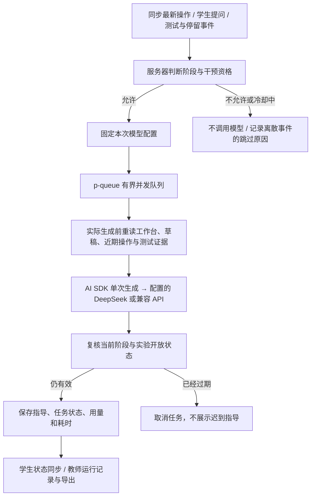

# 智能体架构与选型复核

复核日期：2026-11-03。这里描述实际安装和运行的架构，区分工程验证与教学效果。

## 当前采用的方案

**单教学智能体 + 确定性教学工作流 + Vercel AI SDK + p-queue + SQLite。**

- 学生只有一个教学助理，每次有效指导进行一次模型生成。
- 四种实验条件是“主动/响应 × 线索/详细解释”，是四种干预策略，不是四个相互交接的智能体。
- 阶段权限、测评禁答、仿真结果、证据查询和任务取消由程序执行。模型负责根据已有证据组织指导，不自主修改规则、推进阶段、评分或替学生运行实验。
- 已正式安装 `ai@7.0.162`、`@ai-sdk/openai-compatible@3.0.84` 和 `p-queue@10.0.0`。LangGraph 尚未安装。

## 为什么正式接入 AI SDK，但暂不迁移 LangGraph

之前把“只有一次模型调用”作为不采用 SDK 的主要理由并不充分。框架是否有价值，应看它能否减少当前实际的维护成本。AI SDK 和 LangGraph 分别解决模型接入与流程编排，也可以组合使用。

| 层次 | 当前需要 | 决定及原因 |
|---|---|---|
| 模型接入 | 用户自选兼容 API、消息序列、输出限制、结束原因、用量、中止 | 正式使用 AI SDK 的 `generateText` 和 OpenAI-compatible provider，复用其协议适配；业务仍直接调用用户配置的服务 |
| 教学流程 | 五阶段、四条件、权限与介入频率、一次生成后落库 | 保留现有确定性程序，避免再维护一套与 SQLite 并行的图状态 |
| 调度 | 多学生并发、排队上限、等待时间、取消 | 使用 p-queue；AI SDK 或 LangGraph 本身不会替平台配置服务商配额 |
| 研究记录 | 完整实验数据、模型来源与指导日志 | SQLite 保持唯一业务记录来源，教师可查看和导出运行记录 |

AI SDK 不要求 Next.js，也不要求部署到 Vercel。本平台仍是 React/Vite + Express。通过 provider 实例直接连接已有 Base URL，不使用字符串模型路由到 AI Gateway；不启用外部遥测。保留现有 HTTPS/DNS 限制、中文错误和实际 HTTP 中止。

固定 `maxRetries: 0`，不配置工具循环或自动评审调用。保留温度0.3、既有输出预算、30秒调用超时及 DeepSeek thinking 参数。模型优先级仍是学生个人 → 教师发布的实验默认 → 平台默认；受理时固定模型配置，排队期间修改模型只影响下一条指导。实验状态与证据在实际生成前重读，因此排队期间新保存的操作与草稿能进入本次指导。SDK 没有改变默认模型或 API 密钥。

LangGraph 同样能实现一个模型节点加确定性节点，因此“不使用多智能体”不是排斥 LangGraph 的理由。暂不迁移的实际原因是：当前没有需跨节点恢复的长任务、动态工具规划或等待人工审批后续跑的模型流程；把现有短流程再包一层图不会自动提高回答质量。若后续增加“多份资料检索 → 诊断 → 教师确认 → 分支执行”等持续任务，再引入图及持久检查点才有明确收益。届时应统一状态归属，不能让图检查点与现有业务数据相互覆盖。

## 单智能体还是多智能体

| 考虑方面 | 当前单教学智能体 | 多智能体在本任务中的代价或适用条件 |
|---|---|---|
| 教学目标 | 一个助理围绕学生自己的证据提供适量帮助 | 规划、诊断、解答等角色互相补全，可能逐渐给出完整答案，压缩学生探究空间 |
| 实验可比性 | 四条件共享证据、基础规则和队列，仅在指定维度变化 | 角色数量、交接次数、评审次数又会成为额外干预变量 |
| 响应与费用 | 每次介入一次生成，条件检查与比较不消耗模型调用 | 多次生成或评审通常增加请求量；并行只能缩短可独立工作的部分 |
| 正确性 | 测试编号、变量差异和规则版本由程序提供 | 多个同类模型互相同意不能证明正确，仍须对照真实实验数据 |
| 并发与维护 | 并行服务多名学生，每人至多一个未结束任务 | 每名学生再拆多个角色，会增加状态交接、取消与追踪负担 |
| 扩展 | 可以增加只读证据能力，而不增加模型角色 | 教师端独立的班级统计、资料检索、报告草拟有实际拆分需求时，再评估多角色并行 |

因此当前选择单教学智能体。它不是“一个无上下文聊天框”：外围程序负责阶段、事实、短期对话、证据检索、并发和审计。也不将普通函数模块包装成“多智能体协作”来夸大能力。

研究时仍需关注学生自选模型带来的混杂：已按用户要求保留自由配置，并记录实际模型和来源；正式比较四种干预条件时，应在实验方案中明确统一模型或如何分析模型差异，而不能仅凭界面分组认定条件一致。

## 本轮落实的改进

1. **模型协议复用**：模型生成和结果解析正式交给 AI SDK；SDK 的自动重试关闭，取消会结束底层连接，不静默换模型。
2. **证据按需检索**：保留最近8条测试，另按问题中明确的测试编号读取至多4条历史记录。查询始终限定当前学生；不存在与超出本次检索数量的编号分别说明。历史引用不改变“最近两次测试”的比较事实。
3. **真实上下文预算**：按 JSON 转义后的长度截取草稿等文本；预算紧张时优先保留显式引用和最近两次测试。动态材料上限12000字符，不冒充 token 数，也不删除原始研究记录。
4. **草稿与状态协作**：同页保存按顺序执行；求助等待该次草稿保存。心跳能发现同阶段的测评、规则和测试变化，旧版本业务快照不会覆盖新状态。新客户端的问题携带阶段，服务端拒绝旧阶段问题。
5. **介入记录**：忙碌、冷却、同类提示已发、队列满等离散触发保留跳过原因。已有任务期间不偷偷追加生成，避免改变四组介入频率；空闲心跳不反复写相同跳过日志。
6. **教师可查**：学生档案新增“指导运行”，展示状态、来源、模型、排队/生成耗时、用量和提示词版本；研究数据新增指导运行 CSV。完整 JSON 仍包含所有任务与行为记录。
7. **读取效率**：重复测试判断直接在数据库限制本阶段最近记录数量，避免每次测试遍历全部历史。

当前提示词版本为 `qinghe-v2.6`。系统仍不向模型发送教师参考答案、独立测评答案、其他学生资料、整段仿真时序或 API 密钥。现有已经允许的学生可见规则及历史测试规则保持清楚区分。

## 最新操作与指导连接（2026-11-03）

新增工作台状态同步，保存环境与连接、测试目的和预测、未保存规则草案、观察/设备选择、当前查看阶段及回放编号。连续输入停顿500ms后合并，离散操作及时发送；所有写入串行，求助、运行测试、保存规则和阶段提交前等待最新状态保存。首屏同步只登记当前展示，不自动触发指导。

模型材料新增 `latestWorkspace` 与最近12条教学相关 `recentActions`，明确区分尚未运行设置、未保存草案、生效规则和已完成测试。当前字段多不等于同时修改了多个变量；变化判断必须有操作或对照依据。队列实际执行前重读状态，开始生成后按该次快照回答，不持续修改进行中的模型请求。

仅主动组的实际条件/草案变化可触发新增 `operation` 指导，仍受冷却、同阶段同类去重与已有任务限制；查看设备、观察记录和回放只更新情境。响应组仍只在求助时指导；前后测、首次猜想限制、暂停/结束及 `activeCanAsk` 设置继续生效。普通前台心跳5秒、生成状态1.5秒，后台页停止轮询。

本轮完整回归 **83/83通过**。新增测试覆盖未运行条件、规则草案、分组/独立测评、排队最新状态、串行同步与慢草稿期间立即求助。配置的 `deepseek-flash` 使用合成材料完成4次真实抽测（含一次提示词调整），最终两次为1013ms/1597ms、45/243字符，能区分未运行设置和未保存草案；这是小样本检查，不是所有回答正确性的保证。接口契约和运行边界见[操作同步说明](realtime-state.md)。

## 运行边界与验收

- 默认并发8、等待容量128、排队上限60秒、生成上限30秒；四组共用FIFO队列，无条件特权。真实课堂吞吐取决于服务商的并发、请求和token配额，不能用本机mock速度推断。
- 队列属于单进程，当前服务器应单实例运行。重启会将未完成指导明确标为失败，不自动重放可能已计费的请求；这不是持久任务恢复系统。
- 自动化测试验证权限、顺序、取消、隔离、用量与状态，真实 API 抽测检查合成教学场景。通过这些检查不能保证所有未来回答正确，也不等同已验证学习效果。
- 多标签页可同步业务进度，但不提供多人同时编辑同一份草稿的协同编辑功能。

上一轮AI SDK升级的完整自动化回归 **65/65 通过**（约16.8秒）。覆盖五阶段闭环、四种干预条件、账号与模型选择、排队与取消、重启、证据归属、JSON预算、SDK调用契约、草稿顺序和业务版本；记录在本机 `output/agent-v8-tests.txt`。

浏览器采用隔离账号和本地模型mock：刻意延迟旧草稿保存后，求助仍读取最新草稿；生成中编辑保留；第二标签完成前测后第一标签同步；教师运行状态与CSV下载对应。浏览器无错误或警告。证据位于 `output/agent-ui-v2/results.json` 和 `output/playwright/agent-v2-*.png`。界面测试任务的提示词版本为当时运行的v2.2，后续仅调整后端提示词；最终v2.5另经真实API与上下文测试验证。

最终v2.5使用既有 `deepseek-flash` 完成 **9/9 次真实API请求**，涵盖四种条件、原始观察、反向标定、索要完整答案、编造编号和较早记录。耗时873–2120ms，中位数1646ms；服务商返回输入11633、输出774 token。这些数据只代表最后9条，本轮另有3轮各9条的调优请求，总共36条合成场景调用；没有把真实学生数据送去调试。

人工核对未发现最终样例编造测试、把相同天气说成变化、输出内部布尔值或混淆已提供的规则版本。但**字数目标8/9满足**：一条拒绝编造证据的详细回答为256字符，超过250目标6字符，其余详细回答199–234字符、线索40–59字符。`check:agent` 记录 `lengthTargetMet`，接口完成不能冒充教学约束全部通过。当前字数约束依赖提示词，未用硬截断、自动补写或追加评审调用伪造合格；如研究方案要求严格固定长度，应单独确定违反时的处置和预实验验收门槛。

本地生产服务已更新，健康检查和生产首页通过。数据库版本仍为5，升级前后用户9、报名8、进度2、提交14、测试11、事件102、消息9、指导运行0一致。升级前在线备份为 `backups/lab-2026-11-03T06-25-06-291Z.db`。测试未向正式学生插入指导。

## 官方依据与源码位置

- [LangGraph：Workflows and agents](https://docs.langchain.com/oss/javascript/langgraph/workflows-agents)：预定工作流与自主代理的区分。
- [LangGraph：Persistence](https://docs.langchain.com/oss/javascript/langgraph/persistence)：检查点适用于需要恢复的工作流。
- [LangGraph JS 源码](https://github.com/langchain-ai/langgraphjs)：MIT许可。
- [AI SDK：Generating text](https://ai-sdk.dev/docs/ai-sdk-core/generating-text)：生成接口、结束原因与用量。
- [AI SDK：OpenAI-compatible provider](https://ai-sdk.dev/providers/openai-compatible-providers)：自定义地址、fetch与请求转换。
- [AI SDK：Settings](https://ai-sdk.dev/docs/ai-sdk-core/settings)：重试、中止与输出限制。
- [Vercel AI SDK 源码](https://github.com/vercel/ai)：Apache-2.0许可，使用已发布依赖而非复制陈旧示例。
- [p-queue 源码](https://github.com/sindresorhus/p-queue)：MIT许可，有界并发与任务取消。

实现入口：`backend/src/guidance.js`、`guidance-policy.js`、`guidance-context.js`、`guidance-evidence.js`、`model-client.js`；前端同步入口：`frontend/src/pages/StudentPage.jsx`、`student-sync.js`。
